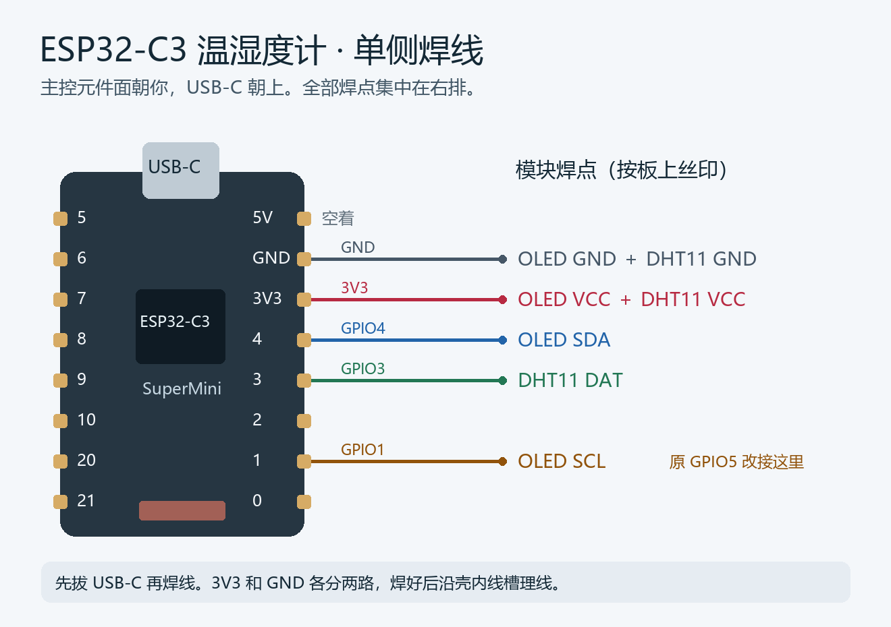

# ESP32-C3 温湿度计 · LAN Thermometer

USB-C 供电的竖屏温湿度计。OLED 每 2.5 秒更新一次，手机和其他 ESP32 可通过家庭 Wi-Fi 读取同一份采样。

A USB-powered DHT11 thermometer with a portrait OLED, a local web dashboard and a JSON endpoint. It works on a local network without internet access.

## 接线 / Wiring

| 模块 / Module | 信号 / Signal | ESP32-C3 SuperMini |
|---|---|---|
| DHT11 module | DATA | GPIO3 |
| I²C OLED | SDA | GPIO4 |
| I²C OLED | SCL | GPIO1 |
| Both modules | VCC / GND | 3V3 / GND |



## 编译与配网 / Build and connect

1. 用 PlatformIO 打开仓库根目录，执行 `pio run -e c3`。通过 USB 连接目标 C3 后执行 `pio run -e c3 -t upload`。
2. 打开 115200 波特率串口监视器。首次启动时，连接串口列出的 `Thermo-Setup-xxxx` 热点，使用同一处显示的设备专属密码。
3. 手机打开 `http://192.168.4.1/`，输入家里的 2.4 GHz Wi-Fi 信息。连接成功后，切回家里 Wi-Fi，打开串口显示的局域网地址。

Build and upload with the PlatformIO commands above. Open the serial monitor at 115200 baud for the device-specific setup SSID and password. Join the hotspot, visit `http://192.168.4.1/` and enter the credentials of a 2.4 GHz network. Join that network to open the device at its printed IP address or mDNS name.

## 手机查看 24 小时曲线 / View the 24-hour charts on your phone

1. 手机连到温湿度计所在的家庭 Wi-Fi。在浏览器打开串口显示的设备主页 `http://thermo-xxxx.local/`（将 `xxxx` 换成实际后缀）。如果手机无法解析这个名称，直接打开串口显示的 IP 地址。
2. 页面顶部显示实时温度和相对湿度。向下滑到「最近 24 小时」，分别查看「温度趋势 · °C」和「湿度趋势 · %」。每张图上方的「最低」「最高」取自该图时间范围内已记录的有效采样点。
3. 上电后，第一笔有效数据会显示为一个点，此时最高和最低相同。约 5 分钟后，第二个有效点就会连成线。缺测时曲线留空。关掉手机页面后设备仍会记录；断电或重启会清空历史。

Connect your phone to the thermometer’s home Wi-Fi and open the device hostname or IP address printed in the serial monitor. Scroll below the live readings to the 24-hour section. The temperature and relative humidity charts each show the lowest and highest recorded values above the plot. The board records one valid sample per five-minute interval and keeps a rolling 24 hours in RAM. A single point has the same minimum and maximum. Missing intervals appear as gaps. Recording continues with the browser closed and starts over after a restart.

## 局域网读取 / Local API

Browse to `http://<device-ip>/` for the dashboard. Other devices can request `GET /api/latest` over HTTP. Any client on the same reachable LAN can read the measurements.

示例响应 / Example response

```json
{"temperature_c":23.8,"humidity_pct":38.0,"online":true,"status":"ok","age_ms":869}
```

`age_ms` 表示距离采样经过的毫秒数。仅在 `online` 为真时使用读数。等待首笔数据、传感器报错或数据过期时，温湿度字段返回 `null`。

Use readings only when `online` is true. The device reports `waiting`, `sensor_error` or `stale` with null measurements when a current sample is unavailable.

## 外壳 / Enclosure

[主壳](enclosure/MainCase.stl) · [滑动后盖](enclosure/RearCover.stl) · [组合支架](enclosure/ComboCarrier.stl)

R10 主壳靠后盖的侧壁和滑轨向后延长 2 mm，为焊线留空间。打印前请按实际模块检查开孔和夹持尺寸。

The R10 enclosure adds 2 mm of wiring clearance behind the boards. Check fit against your modules before printing.

## 验证 / Verification

原型上验证了传感器、局域网页面和 JSON 接口，并将接口读数与串口对照。此仓库的配网密码和主机名按设备生成。

The prototype was checked over the LAN against its serial readings. This repository generates a device-specific setup password and derives the host name from the board address.

## 硬件清单 / Parts list

| 数量 / Qty | 部件 / Part |
|---|---|
| 1 | ESP32-C3 SuperMini 开发板，自带 USB-C / controller board |
| 1 | 四针 I²C OLED 屏幕模块 / display module |
| 1 | DHT11 三针温湿度模块 / temperature and humidity sensor module |
| 若干 / as needed | 细绝缘导线 / insulated hookup wire |
| 1 | USB 供电线 / USB power cable |

这套硬件由模块焊线连接。接线图和上方引脚表对应同一版固件。

## 结构设计文件 / Mechanical design files

- [FreeCAD 原模型 / Native model](enclosure/thermo-r10-deeper-shell.FCStd)
- [STEP 交换模型 / CAD exchange](enclosure/thermo-r10-deeper-shell.step)
- [拓竹 A1 主壳打印工程 / Bambu Studio main-case plate](enclosure/thermo-R10-main-case-A1.3mf)

3MF 只含 R10 主壳。打印整套时，还需使用上方的后盖和组合支架 STL。请在 Bambu Studio 中按自己的打印机、喷嘴和耗材重新切片。

The 3MF contains the main case only. Use the rear cover and carrier STL files for the other two pieces and slice for your printer, nozzle and filament.
